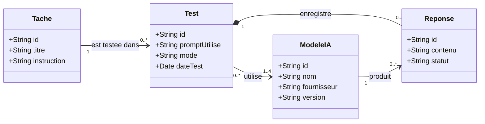

# Diagramme de classes : Exercice 7B

**Projet :** Artificial Inquiries  
**Sujet :** Choosing the Models  
**Objectif :** sélectionner quatre modèles d'IA et préparer leur comparaison à partir d'instructions identiques.

## 1. Diagramme de classes

## 2. Description des classes

### ModeleIA
Représente les modèles sélectionnés pour l'exercice :

- ChatGPT — OpenAI
- Claude — Anthropic
- Mistral — Mistral AI
- Kimi — Moonshot AI

Chaque modèle possède un identifiant, un nom, un fournisseur et une version.

### Tache
Représente une tâche à réaliser par les modèles.

Chaque tâche contient :
- Un identifiant
- Un titre
- Une instruction (prompt)

Les instructions définitives proviendront de l'exercice 7A.

### Test
Représente une exécution d'une tâche avec un ou plusieurs modèles.

Il contient :
- Un identifiant
- Le prompt utilisé
- Le mode de test : individuel ou simultané
- La date du test

### Reponse
Stocke le résultat généré par un modèle.

Elle contient :
- Un identifiant
- Le contenu de la réponse
- Le statut (réussite ou erreur)

Chaque réponse est associée à un test et à un modèle.

## 3. Fonctionnement de l'application

L'application proposera une interface simple :

**Étape 1 — Saisie du prompt**

L'utilisateur sélectionne une tâche ou saisit directement une instruction dans un champ de texte.

**Étape 2 — Sélection des modèles**

Deux possibilités :
- Tester un modèle individuellement.
- Tester les quatre modèles en même temps.

**Étape 3 — Exécution**

Le même prompt est envoyé aux modèles sélectionnés.

En mode simultané, les quatre appels aux modèles pourront être lancés en parallèle.

**Étape 4 — Enregistrement**

Chaque réponse est enregistrée avec :
- Le modèle utilisé
- Le test correspondant
- Le contenu généré
- Le statut de l'exécution

**Étape 5 — Consultation**

Les réponses pourront être affichées côte à côte pour faciliter leur comparaison.

## 4. Relations entre les classes

- Une tâche peut être utilisée dans plusieurs tests.
- Un test concerne un seul modèle ou les quatre modèles.
- Un test peut enregistrer jusqu'à quatre réponses.
- Un modèle peut produire plusieurs réponses dans différents tests.
- Chaque réponse appartient à un seul test et à un seul modèle.

Un modèle produit au maximum une réponse par test.

## 5. Intégration avec Omeka S

Les données seront organisées dans Omeka S à l'aide de ressources et de relations.

Les modèles, tâches, tests et réponses pourront être représentés par des items liés entre eux.

Les appels aux API des modèles seront réalisés par une application externe. Omeka S servira à stocker, organiser et consulter les résultats.

## 6. Résultat attendu

L'objectif est de préparer un système permettant :

1. De sélectionner les modèles d'IA.
2. De saisir une instruction commune.
3. De lancer un test individuel ou simultané.
4. D'enregistrer les réponses obtenues.
5. De consulter et comparer les résultats.

La sélection des modèles correspond à l'exercice 7B. L'exécution des tests et la collecte des réponses préparent le travail de l'exercice 8.
